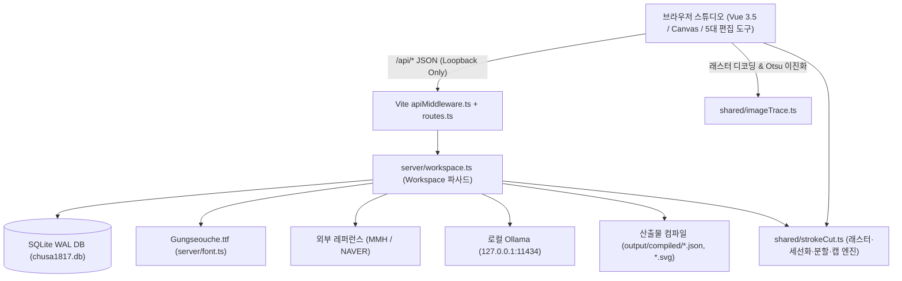
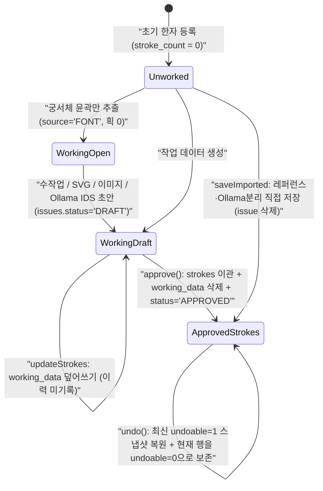

# 추사 1817 (`font2svg`) 코드베이스 로직 상세 분석

> 기준 경로: `/Users/yutaek/zWorkSpace/zBasis/chusa1817/font2svg`
> 분석 범위: `app/server/`, `app/shared/`, `app/src/`, `app/scripts/`, `app/vite.config.ts`, `app/index.html`, `.github/workflows/ci.yml`

---

## 1. 시스템 개요 및 전체 아키텍처

### 1.1 프로젝트 목적 및 기술 스택
**추사 1817 | 한자 필순 추출 스튜디오(`font2svg-extract`)**는 궁서체 TTF(`app/fonts/Gungseouche.ttf`) 글리프 윤곽을 오픈소스 레퍼런스(Make Me a Hanja, 네이버 한자사전), 래스터 이미지 트레이싱, IDS 합성 및 로컬 Ollama 추론과 결합하여 획 단위로 분리하고, 클리핑·마스크 기반 필순 애니메이션용 정적 산출물(`output/compiled/<한자>.json`, `.svg`)을 생성하는 로컬 웹 어드민 스튜디오다.

| 계층 | 주요 기술 및 제약 사항 |
| :--- | :--- |
| **런타임** | Node.js 24 이상(내장 `node:sqlite`, TypeScript 직접 실행) |
| **개발 서버 & API** | Vite 8 (`app/vite.config.ts`의 `workspaceApi` Connect 미들웨어), 루프백 전용 HTTP API(`/api/*`) |
| **프론트엔드** | Vue 3.5 (`<script setup lang="ts">`), 외부 UI/상태관리 라이브러리 미사용, 순수 Composable 아키텍처 |
| **타입/정적 검증** | TypeScript 6 (`npm:@typescript/typescript6`, `vue-tsc` v3 호환성 유지용 별칭), ESLint 10, Knip 6 |
| **외부 데이터/추론** | `opentype.js` 2.0 (로컬 TTF 파싱), 로컬 Ollama (`127.0.0.1:11434`), MMH/Naver HTTP 페치 |

### 1.2 디렉터리 구조 및 모듈 경계 원칙
```text
app/
  shared/     서버(server)와 화면(src)이 공유하는 타입, 상수, 경로 파서, 이미지 트레이싱, strokeCut 엔진
  server/     SQLite DB, 마이그레이션, TTF/레퍼런스/Ollama/컴파일 파이프라인, API 라우터 (src를 참조하지 않음)
  src/        Vue 3 스튜디오 UI: components(표시), composables(상태·도구·명령), lib(순수 계산/API)
  scripts/    독립 CLI 보조 스크립트 (DB 백업)
  tests/      node:test 기반 서버·공유 엔진·화면 순수 로직 단위 테스트
database/     SQLite DB (chusa1817.db), 내려받은 IDS.TXT, 백업 파일 (Git 제외)
output/       컴파일 산출물 (compiled/<한자>.json, .svg) (Git 제외)
```

**핵심 아키텍처 불변식**:
1. **`shared` 단방향 의존**: `server/`와 `src/`는 모두 `shared/`를 임포트하지만, `server/`는 `src/`를 임포트하지 않으며 `src/`는 `server/`를 임포트하지 않는다.
2. **빌드 시 DB 비접근**: `vite.config.ts`는 `configureServer` 훅에서만 `getWorkspace(rootDir)`를 호출한다. 따라서 `npm run build` (`vite build`) 실행 시에는 SQLite DB 파일을 열거나 마이그레이션하지 않는다.
3. **오프라인 우선 정적 자원**: 화면 폰트(`PretendardVariable.woff2`)는 외부 CDN이 아니라 `app/public/fonts/`에서 직접 서빙하여 외부 네트워크 지연이 스크립트 실행을 막지 않도록 설계되었다.



### 1.3 좌표계 규약 및 변환 공식
전체 시스템의 기준 저장 좌표계는 **`CANVAS = 1024`**(`0..1024`, **y축 위쪽 증가 / y-up**)이며 `COORD_ROUND = 10`(소수 첫째 자리, `COORD_DECIMALS = 1`) 기준으로 반올림한다.

| 대상 소스 / 렌더링 | 원점 및 Y축 방향 | 저장 좌표계 `(x', y')` 변환 공식 또는 역변환 | 구현 위치 |
| :--- | :--- | :--- | :--- |
| **DB 저장 좌표 (`strokes`, `working_data`)** | 좌하단 `(0, 0)`, y-up, `0..1024` | 기준 좌표계 (소수 첫째 자리 반올림) | `shared/constants.ts` |
| **화면 SVG 및 출력 SVG (`animatedSvg`)** | 좌상단 `(0, 0)`, y-down | `#canvas-world` 그룹에 `translate(0 1024) scale(1 -1)` 적용 | `LayerCanvas.vue`, `animSvg.ts` |
| **TTF 궁서체 (`Gungseouche.ttf`)** | Font units, `getPath`는 y-down | `scale = 1024 / unitsPerEm`, `x' = round(x * scale)`, `y' = round(-y * scale + 95)` (`BASELINE_SHIFT = 95`) | `server/font.ts` |
| **AnimCJK SVG (원본)** | y-down (`ACJK_SVG_Y_ORIGIN = 900`) | `x' = round(x)`, `y' = round(900 - y)` (단 `translate(0 1024) scale(1 -1)` 포함 자체 SVG는 변환 생략) | `server/animSvg.ts` |
| **네이버 한자사전 SVG** | `<g transform="scale(1,-1) translate(tx, ty)">` | `x' = round(x + tx)`, `y' = round(900 + ty + y)` | `server/animSvg.ts` |
| **strokeCut 래스터 격자 (`Raster`)** | 좌상단 `(0, 0)`, y-down, 사방 `PAD=16` | `gx = pad + (x - minX) * scale`, `gy = pad + (maxY - y) * scale` (`TARGET = 560`) | `shared/strokeCut/raster.ts` |

---

## 2. 데이터베이스 스키마, 마이그레이션 및 상태 생명주기

### 2.1 연결 설정, 중첩 트랜잭션 및 백업 검증
- **초기화 (`app/server/workspace.ts`)**: `createWorkspace(rootDir)`는 `database/chusa1817.db`를 열고 다음 PRAGMA를 적용한 뒤 `migrate` → `seed`를 순서대로 실행한다.
  - `PRAGMA foreign_keys = ON`
  - `PRAGMA journal_mode = WAL`
  - `PRAGMA busy_timeout = 5000` (`DB_BUSY_TIMEOUT_MS`)
- **중첩 트랜잭션 (`app/server/db.ts`)**:
  - `transaction(db, work)`는 모듈 수준 `WeakMap<DatabaseSync, number>`(`depthByDb`)로 DB 연결별 트랜잭션 중첩 깊이를 추적한다.
  - 최외곽(`depth === 0`)은 `BEGIN` / `COMMIT` / `ROLLBACK`을 사용하고, 내부 중첩(`depth > 0`)은 `SAVEPOINT sp_<depth>` / `RELEASE sp_<depth>` / `ROLLBACK TO sp_<depth>`를 사용하여 상위 트랜잭션을 깨지 않고 부분 롤백을 지원한다.
- **무결성 검증 백업 (`app/server/dbBackup.ts`, `app/scripts/backupDb.ts`)**:
  - `backupDatabase(db, destination)`은 대상 경로에 이미 파일이 있으면 덮어쓰지 않고 예외를 던진다.
  - `VACUUM INTO ?`로 WAL 로그까지 병합한 단일 스냅샷을 만든 뒤, 생성된 파일을 `readOnly: true`로 다시 열어 `PRAGMA integrity_check` 결과가 `'ok'`인지 검증하고 바이트 크기를 반환한다.
  - CLI `npm run backup` (`scripts/backupDb.ts`)은 DB를 읽기 전용으로 열어 `<DB명>.backup-<YYYYMMDD-HHmmss>.db`로 저장한다.

### 2.2 전체 테이블, 인덱스 및 트리거 명세 (`app/server/schema/`)
총 **10개 테이블**, **2개 보조 인덱스**, **1개 트리거**로 구성된다.

| 테이블 | 정의 위치 | 주요 컬럼 및 제약 조건 |
| :--- | :--- | :--- |
| **`project_meta`** | `upgrades.ts` (v2) | `id INTEGER PRIMARY KEY CHECK (id = 1)`, `project_name`, `ttf_filename`, `ttf_sha256`, `ttf_units_per_em`, `canvas_size` (1024), `default_stroke_width` (135), `stroke_order_standard` ('KR'), `created_at`, `updated_at` |
| **`radicals`** | `upgrades.ts` (v2) | `id INTEGER PRIMARY KEY CHECK (id BETWEEN 1 AND 214)`, `radical_char TEXT NOT NULL UNIQUE`, `variant_chars TEXT` (JSON 문자열 배열), `reading`, `meaning`, `stroke_count` |
| **`characters`** | `ddl.ts` | `unicode TEXT PRIMARY KEY`, `char TEXT NOT NULL UNIQUE`, `grade`, `reading`, `meaning`, `variant_reading JSON` (array 검증), `variant_meaning JSON` (array 검증), `stroke_count DEFAULT 0`, `last_modified_at`, `last_modified_by` |
| **`issues`** | `ddl.ts` | `char TEXT PRIMARY KEY REFERENCES characters(char) ON DELETE CASCADE`, `reason`, `created_at`, `status CHECK (status IN ('OPEN', 'DRAFT', 'APPROVED')) DEFAULT 'OPEN'`, `in_font CHECK (in_font IN (0, 1)) DEFAULT 0` |
| **`strokes`** | `ddl.ts` | `char TEXT PRIMARY KEY REFERENCES characters(char) ON DELETE CASCADE`, `radical BETWEEN 0 AND 214`, `font_outline JSON` (array), `stroke_outlines JSON` (array, **길이 >= 1 필수**), `median_line JSON` (array, **`length = stroke_outlines length` 일치 필수**), `last_modified_at`, `last_modified_by`, `origin CHECK (origin IN ('MMH', 'NAVER', 'IDS', 'OLLAMA_IDS', 'MANUAL', 'NONE'))`, `origin_url` |
| **`strokes_history`** | `ddl.ts` | `id INTEGER PRIMARY KEY AUTOINCREMENT`, `char REFERENCES characters(char) ON DELETE CASCADE`, `radical`, `font_outline`, `stroke_outlines`, `median_line`, `origin`, `origin_url`, `state_modified_at`, `state_modified_by`, `action_desc`, `changed_by`, `changed_at`, `undoable CHECK (undoable IN (0, 1)) DEFAULT 1` |
| **`working_data`** | `ddl.ts` | `char TEXT PRIMARY KEY REFERENCES characters(char) ON DELETE CASCADE`, `source CHECK (source IN ('IDS', 'OLLAMA_IDS', 'MANUAL', 'FONT'))`, `source_url`, `font_outline JSON`, `stroke_outlines JSON` (**0개 허용**), `median_line JSON` (`length = stroke_outlines length`), `last_modified_at`, `last_modified_by` |
| **`character_layers`** | `ddl.ts` | `char REFERENCES characters(char) ON DELETE CASCADE`, `layer_id`, `kind CHECK (kind IN ('FONT', 'OUTLINE', 'MMH', 'NAVER', 'STROKES', 'MEDIANS', 'NUMBERS', 'CUSTOM'))`, `name`, `z_index`, `visible (0\|1)`, `opacity [0..1]`, `locked (0\|1)`, `label_color`, `strokes_json JSON`, `paths_json JSON`, `modified (0\|1)`, `updated_at`, **`PRIMARY KEY (char, layer_id)`** |
| **`reference_data`** | `upgrades.ts` (v2) | `unicode`, `source`, `source_version`, `source_url`, `raw_data`, `raw_sha256`, `found INTEGER`, `fetched_at`, **`PRIMARY KEY (unicode, source)`**, **`FOREIGN KEY (unicode) REFERENCES characters(unicode) ON DELETE CASCADE`** |
| **`conversions`** | `ddl.ts` (v3) | `id INTEGER PRIMARY KEY AUTOINCREMENT`, `char REFERENCES characters(char) ON DELETE CASCADE`, `kind CHECK (kind IN ('IMAGE_TO_SVG'))`, `source_name`, `source_mime`, `source_sha256` (길이 64), `source_width > 0`, `source_height > 0`, `threshold BETWEEN 0 AND 255`, `invert (0\|1)`, `mode CHECK (mode IN ('GUIDED', 'COMPONENTS'))`, `destination CHECK (destination IN ('STROKES', 'WORKING'))`, `stroke_count >= 1`, `result_svg`, `created_by`, `created_at` |

- **보조 인덱스**: `idx_strokes_history_char ON strokes_history(char, id DESC)`, `idx_conversions_char ON conversions(char, id DESC)`.
- **트리거 (`trg_characters_updated`)**: `AFTER UPDATE ON characters WHEN NEW.last_modified_at = OLD.last_modified_at`일 때 `last_modified_at = CURRENT_TIMESTAMP` 자동 갱신.

### 2.3 스키마 마이그레이션 및 시드 (`migrate.ts`, `upgrades.ts`, `seed.ts`)
- **버전 관리 (`PRAGMA user_version`)**: 현재 `SCHEMA_VERSION = 4`. 실행 중인 앱보다 DB의 `user_version`이 높으면 다운그레이드 손상을 막기 위해 즉시 예외를 던진다.
- **마이그레이션 전 자동 백업**: `characters` 테이블이 이미 존재하는 DB에 대기 중인 마이그레이션(`version > current`)이 있으면 적용 직전 `backupDatabase`로 `<DB명>.before-v<current>-<timestamp>.db`를 자동 백업한다.
- **버전별 업그레이드 내역**:
  - **v1**: `user_version` 추적 도입 기준점.
  - **v2 (`upgradeToV2`)**: 10단계 레거시 보정 및 테이블 보장 — ① `characters` 컬럼 정리(`korean_reading` → `reading`, `variant_*` 추가, `issues` 이관 및 FK 검사), ② 구 `characters.status` 및 인덱스 제거, ③ `strokes.radical` 컬럼 추가 및 `stroke_outlines`의 `radical` 0/1 정규화, ④ `strokes.origin`에 `'NAVER'` 허용 재구성, ⑤ 기본 테이블 8종 및 `trg_characters_updated` 보장, ⑥ `character_layers.kind`에 `'OUTLINE'` 추가, ⑦ `reference_data.source_url` 추가, ⑧ `radicals.name_kr`을 `meaning`/`reading`으로 분리, ⑨ 구 `edit_history` 테이블을 `strokes_history`로 이관 후 삭제, ⑩ `working_data` 테이블이 아직 없을 때만 기존 `strokes`의 초안(`IDS`, `OLLAMA_IDS`, `MANUAL`)을 `strokes_history(undoable=0)`에 기록한 뒤 `working_data`와 `issues(status='DRAFT')`로 이관.
  - **v3 (`upgradeToV3`)**: `CONVERSIONS_DDL` 실행(`conversions` 테이블 및 인덱스 추가).
  - **v4 (`upgradeToV4`)**: AnimCJK 제거. `reference_data`의 ACJK 행·`acjk` 레이어 행을 지우고, `origin='ACJK'`는 `MANUAL`로, `system:acjk` 작업자는 `system:migration`으로 바꾼 뒤 `strokes`·`character_layers`를 CHECK에서 ACJK를 뺀 새 표로 갈아끼운다(`docs/references/animcjk.md`).
- **시드 (`seed.ts`, `radicals.ts`)**: `radicals`가 비어 있으면 강희자전 214부수(`KANGXI_RADICALS`)를 삽입하고, `project_meta(id=1)`가 없으면 기본 프로젝트 메타(`'추사 1817'`, `NO_FONT_SHA256 = '0'.repeat(64)`)를 생성한다.

### 2.4 `working_data` ↔ `strokes` 이중 생명주기 및 파싱 정책
`app/server/strokeStore.ts`는 승인 전 초안(`working_data`)과 확정 본선 데이터(`strokes`)를 분리해 관리한다.



- **승인(`approve`)**: `working_data`에 획이 1개 이상 있고 `strokes`에 행이 없을 때만 실행 가능하다. `compileOutput.validate` 통과 후 단일 트랜잭션으로 `replaceStrokes`를 호출해 `strokes`로 옮기고 `working_data`를 지운 뒤 `issues.status = 'APPROVED'`로 변경한다.
- **비파괴적 실행 취소(`undo`)**: `strokes`에 행이 있고 `strokes_history`에 `undoable = 1` 스냅샷이 있을 때 동작한다. 기존 행을 지우는 대신 ① 현재 `strokes` 상태를 `action_desc = '실행 취소'`(`undoable = 0`)로 `strokes_history`에 추가하고, ② 복원 대상 `target.id`의 `undoable`을 `0`으로 바꾼 뒤, ③ `strokes`와 `characters.stroke_count`를 `target` 내용으로 덮어쓴다.
- **엄격 파싱 vs 관대한 표시 파싱**:
  - `app/server/storedJson.ts` (`parseStringArray`, `parseStrokeOutlines`, `parseMedianLines`): DB 핵심 열(`strokes`, `working_data`, `characters`)을 읽을 때 손상된 JSON을 빈 배열로 대체하면 후속 저장이 원본 데이터를 영구 덮어쓸 위험이 있으므로 **즉시 예외를 던진다**.
  - `app/server/layerData.ts` (`parseStoredStrokes`, `parseStoredPaths`): 보조 레이어(`character_layers`) 표시용 파서는 화면 크래시를 막기 위해 손상 시 `warnOnce` 1회 경고 후 `[]`를 반환한다.

---

## 3. HTTP 보안 미들웨어 및 REST API 전체 명세

### 3.1 보안 미들웨어 및 요청 제한 (`apiMiddleware.ts`, `http.ts`, `routes.ts`)
- **루프백 접근 제어 (`http.ts`)**: `LOOPBACK_ADDRESSES` (`'127.0.0.1'`, `'::1'`, `'::ffff:127.0.0.1'`) 외 원격 주소의 `/api/*` 요청은 `403 Forbidden`으로 차단한다. `/api/`로 시작하지 않는 경로는 Vite 정적 파일·HMR 미들웨어로 통과한다.
- **본문 크기 및 JSON 파싱**: `readJsonBody`는 스트림 청크를 모으다 `API_BODY_LIMIT_BYTES (8 MiB)`를 초과하면 즉시 요청 읽기를 중단하고 `400`을 반환한다. 빈 본문은 `{}`로 취급한다.
- **Promise Rejection 방어**: Connect 미들웨어는 반환된 Promise를 대기하지 않으므로 `apiMiddleware.ts`가 최상위 `.catch()`로 예외를 잡아 `warnOnce('api-middleware', error)` 기록 후 `500 Internal Server Error`를 응답해 개발 서버 프로세스 중단을 막는다.
- **라우트 검증 (`routes.ts`)**: `:unicode` 경로 파라미터는 `decodeURIComponent` 결과가 `'U+'`로 시작해야만 매칭된다. 핸들러가 내부 표식 `NotFound`를 반환하면 `404`, 도메인 예외를 던지면 `400` (`{ error }`)으로 응답한다.

### 3.2 전체 REST API 명세 (29개 엔드포인트)

| # | Method | Endpoint (`/api/...`) | Workspace 핸들러 | 요청 Payload / Query | 응답 (`200 OK`, 예외 시 `400`/`404`) |
| :---: | :---: | :--- | :--- | :--- | :--- |
| 1 | `GET` | `/api/characters` | `listCharacters(q)` | Query `q?: string` | `CharacterSummary[]` |
| 2 | `GET` | `/api/radicals` | `listRadicals()` | - | 강희자전 214부수 목록 |
| 3 | `GET` | `/api/ollama/status` | `getOllamaStatus()` | - | `OllamaStatus` (`connected`, `models`, `defaultModel`, `url`, `error?`) |
| 4 | `POST` | `/api/import` | `importInitial` | 배열 또는 `{ entries: [{ 한자, 구분?, 음?, 훈? }] }` | `{ imported: number }` |
| 5 | `POST` | `/api/apply-font` | `applyFontBatch` | `{ after?: string, limit?: number }` (기본 `10`) | `{ processed, counts, rejected, noGlyph, next }` |
| 7 | `GET` | `/api/characters/:unicode` | `getCharacter` | Path `:unicode` (`U+...`) | `CharacterDetail` (없으면 `404`) |
| 8 | `POST` | `/api/characters/:unicode/strokes` | `updateStrokes` | `{ strokes: StrokeRecord[], action?: string }` | `CharacterDetail` |
| 9 | `POST` | `/api/characters/:unicode/import-svg` | `importSvg` | `{ svg?: string }` | `CharacterDetail` |
| 10 | `POST` | `/api/characters/:unicode/import-image` | `importImage` | `{ contours, image: { name, mime, sha256, width, height, threshold, invert }, split? }` | `CharacterDetail` |
| 11 | `GET` | `/api/characters/:unicode/conversions` | `listConversions` | - | `ConversionRow[]` (`id DESC`) |
| 12 | `POST` | `/api/characters/:unicode/approve` | `approve` | - | `CharacterDetail` |
| 13 | `POST` | `/api/characters/:unicode/undo` | `undo` | - | `CharacterDetail` |
| 14 | `POST` | `/api/characters/:unicode/apply-naver` | `applyNaver` | `{ write?: 'replace' \| 'append' }` | `CharacterDetail & { fit_status, unmatched_strokes }` |
| 15 | `POST` | `/api/characters/:unicode/ollama-ids` | `inferOllamaIds` / `applyOllamaIds` | `{ mode?: 'infer', model?, ids?, write? }` | `infer`: `OllamaIdsPreview`, 적용: `CharacterDetail & { fit_status, unmatched_strokes, ids, model }` |
| 16 | `POST` | `/api/characters/:unicode/ollama-split` | `splitFontWithOllama` | `{ source?: 'NAVER' \| 'MMH', model?, write? }` | `CharacterDetail & { fit_status, unmatched_strokes, source, model }` |
| 17 | `POST` | `/api/characters/:unicode/compile` | `compile` | - | `CompiledGlyphJson` (디스크 JSON/SVG 생성 포함) |
| 18 | `POST` | `/api/characters/:unicode/outline/generate` | `generateOutline` | `{ sourceLayerId?: string }` | `CharacterDetail` |
| 19 | `POST` | `/api/characters/:unicode/outline/map` | `mapOutlineStroke` | `{ strokeIndex: number, contours: number[] }` | `CharacterDetail` |
| 20 | `POST` | `/api/characters/:unicode/outline/refresh` | `refreshOutline` | - | `CharacterDetail` |
| 21 | `POST` | `/api/characters/:unicode/layers-meta` | `updateLayersMeta` | `{ patches: LayerMetaPatch[] }` | `CharacterDetail` |
| 22 | `POST` | `/api/characters/:unicode/resegment` | `resegmentLayer` | `{ medians: Pt[][] }` | `{ outlines, medians, widths }` |
| 23 | `POST` | `/api/characters/:unicode/layers` | `duplicateLayer` | `{ sourceLayerId?: string, name?: string }` | `{ createdId, detail: CharacterDetail }` |
| 24 | `DELETE` | `/api/characters/:unicode/layers/:layerId` | `deleteLayer` | Path `:layerId` (`CUSTOM`만 삭제 가능) | `CharacterDetail` |
| 25 | `POST` | `/api/characters/:unicode/layers/:layerId/save` | `saveLayer` | `{ strokes?, paths?, action? }` | `CharacterDetail` |
| 26 | `POST` | `/api/characters/:unicode/layers/batch` | `saveLayers` | `{ layers: Array<{ id, strokes?, paths?, action? }> }` | `CharacterDetail` |
| 27 | `POST` | `/api/characters/:unicode/layers/:layerId/reset` | `resetLayer` | - | `CharacterDetail` |
| 28 | `POST` | `/api/characters/:unicode/layers/:layerId/fetch` | `fetchLayer` | Path `:layerId` (`naver` \| `mmh`) | `CharacterDetail` |
| 29 | `POST` | `/api/characters/:unicode/layers/:layerId/apply` | `applyLayerToStrokes` | `{ mode?: 'direct' \| 'fit_font', write?: 'replace' \| 'append' }` | `CharacterDetail` (참고 레이어는 `+ fit_status, unmatched_strokes`) |

---

## 4. 서버 도메인 파이프라인 상세 로직

### 4.1 TTF 폰트 파싱 및 배치 적용 (`font.ts`, `fontApply.ts`)
- **`hideMacRomanCmap(copy)` (`app/server/font.ts`)**: `opentype.js`가 SFNT `cmap` 테이블에 Mac Roman(플랫폼 1, 인코딩 0) 하위 표가 있으면 유니코드 표보다 먼저 읽어 실패하는 문제를 피하기 위해, 메모리 사본의 해당 서브테이블 인코딩 번호를 `0xFFFF` (`UNUSED_ENCODING`)로 덮어써 Unicode format 4 표를 선택하게 한다(디스크의 원본 TTF는 수정하지 않음).
- **폰트 지문 검증 (`getFont` in `fontApply.ts`)**: `app/fonts/Gungseouche.ttf`를 지연 로드하며 `project_meta.ttf_sha256`이 `NO_FONT_SHA256`이면 파일명·SHA-256·`unitsPerEm`을 최초 등록하고, 이미 다른 해시가 기록돼 있으면 즉시 예외를 던져 다른 폰트 혼용을 차단한다.
- **`fontOrGiven` vs `fitOrGiven`**: `fontOrGiven`은 엄격 품질 검사(`splitByContours`) 통과 시에만 궁서체 윤곽을 쓰고 실패하면 입력을 그대로 반환한다. `fitOrGiven`은 관대 분할(`fitGuideToFont`)을 시도해 일부 획이 실패해도 `unmatched` 번호를 반환하여 사용자가 화면에서 수정할 수 있게 한다(`fitted`, `partial`, `copied`, `no-font` 상태 반환).
- **배치 적용 (`applyFontBatch`)**: 커서 기반으로 10자(`FONT_BATCH_LIMIT`)씩 처리하며 `last_modified_by === 'user'`(사람이 수정)와 `'system:font'`(이미 적용)는 건너뛴다. 완료 후 `PRAGMA wal_checkpoint(TRUNCATE)`를 실행한다.

### 4.2 외부 레퍼런스 캐시 및 SVG 변환 (`references.ts`, `referencePipeline.ts`, `animSvg.ts`)
- **3종 레퍼런스 소스**:
  - `MMH`: `hanzi-writer-data@2.0` CDN JSON (`strokes`, `medians`, `radStrokes`).
  - `NAVER`: 네이버 한자사전 `aniSVG_2026_04` SVG.
- **부정 캐시(`found = 0`) 오염 방지**: `fetchHanja`와 `fetchNaver`는 HTTP `404`일 때만 `{ value: null }`을 반환해 `reference_data`에 `found = 0`으로 기록하고, 타임아웃·5xx 오류·SVG 루트 글자 불일치는 예외를 던져 `loadSource`가 `reference_data`에 저장하지 않도록 한다.
- **`naver` 재시도 정책**: `fetchLayer`에서 `LAYER_ID.naver`는 `retryMiss: true`가 설정되어 있어, 이전에 `found = 0`으로 캐시됐더라도 호출 시 해당 부정 캐시 행을 삭제하고 재수신한다.
- **`animatedSvg(unicode, outlines, medians, widths)` (`animSvg.ts`)**: `viewBox="0 0 1024 1024"`, `pathLength = 3333` (`ANIM_PATH_LENGTH`), `stroke-dasharray: 3337`, `stroke-dashoffset: 3339` 설정으로 각 획이 `0.8s` 동안 `1s` 간격 지연으로 그려지는 독립 실행 애니메이션 SVG를 생성한다.

### 4.3 래스터 이미지 → 획 SVG 변환 (`imageRequests.ts`, `conversions.ts`)
1. 클라이언트가 `imageDecode.ts` + `shared/imageTrace.ts`로 추출한 `contours`(최대 24개, `0..1024` 범위 검증)와 이미지 메타·SHA-256을 `POST /api/characters/:unicode/import-image`로 전송한다(원본 이미지 바이트는 전송하지 않음).
2. 서버(`conversions.ts`)는 `request.split === 'AUTO'`이면서 기존 획(또는 작업 획) 길잡이가 **2획 이상**일 때 `GUIDED` 모드(`splitByContours`)로 윤곽을 분할하고, 그 외에는 `COMPONENTS` 모드(`strokesFromComponents`)로 각 연결 덩어리를 1획으로 변환한다.
3. 기존 `strokes` 행이 있으면 `replaceStrokes`(이력 기록, `destination = 'STROKES'`), 없으면 `working_data`에 저장(`issues.status = 'DRAFT'`, `destination = 'WORKING'`)하고, 결과 `animatedSvg`와 함께 `conversions` 테이블에 단일 트랜잭션으로 기록한다.

### 4.4 레이어 시스템, 윤곽 매핑 및 분할 품질 검사 (`layers.ts`, `layerWrites.ts`, `outlineMapping.ts`, `geometry.ts`)
- **기본 레이어 스택 (`BUILTIN_LAYERS`)**: `font` (z=0, 불투명도 0.35, 잠금), `outline` (z=1, 숨김), `mmh` (z=2, 잠금), `naver` (z=4, 잠금), `strokes` (z=5, `working`이면 `'작업 획 (초안)'`), `medians` (z=6), `numbers` (z=7).
- **불변식**:
  - 참고 레이어(`MMH`, `NAVER`)는 DB 설정과 무관하게 항상 `locked: true`로 강제되며 직접 내용 수정이 차단된다.
  - `OUTLINE` 레이어는 현재 궁서체 윤곽의 SHA-256 앞 12자리(`fontFingerprint`)와 각 획의 `font_hash`를 대조해 불일치 시 `stale: true`를 표시한다.
- **`OUTLINE` 윤곽 매핑 (`outlineMapping.ts`)**:
  - `generate`: `sourceLayerId → strokes → naver → mmh` 순으로 길잡이를 찾아 `splitOutlinePieces`를 실행한다. 기존 `outline` 레이어와 획 수가 같으면 수동 매핑(`map_manual = 1`)된 획을 보존하지만, 수동 매핑 획이 있는 상태에서 획 수가 달라지면 예외를 던져 수작업 유실을 막는다.
  - `mapStroke`: `stale` 상태면 차단하며, 전달된 궁서체 윤곽 인덱스를 공백으로 합쳐 `outline_path`로 두고 `map_manual = 1`을 기록한다(빈 배열 전달 시 `ribbonPath`와 `map_manual = 0`으로 매핑 해제).
  - `refresh`: 획 모양은 유지한 채 현재 궁서체 윤곽과의 교차 비율로 `font_contours`와 `font_hash`만 갱신한다.
- **기하 분할 모드 비교 (`geometry.ts`)**:
  - **엄격 분할 (`splitByContours`)**: `fitMediansToOutline`(`MEDIAN_BBOX_INSET = 20`) 후 `segmentOutlineByMedians` 실행. 어느 한 획이라도 비거나 원본 전체와 같거나, 글자 면적의 `0.005` 미만(`MIN_STROKE_AREA_RATIO`)이거나, 중심선 2점 미만이거나, 전체 면적 대비 덮임 비율 `covered / glyphArea`가 `[0.85, 1.7]` 범위를 벗어나면 전체를 `null`로 거부한다.
  - **관대 분할 (`splitOutlinePieces`, `fitGuideToFont`)**: 실패한 획만 중심선 기반 `ribbonPath`와 빈 `contours: []`로 대체하고 1-based `unmatched` 배열에 담아 반환한다. 성공한 획은 꼭짓점의 `10%` 이상이 궁서체 윤곽선 거리 `6` 이내에 놓이는 윤곽 인덱스를 `font_contours`로 기록한다.
- **`applyLayerToStrokes` (`workspace.ts`)**: 참고 레이어이거나 `mode === 'fit_font'`이면 `fitGuideToFont` → 실패 시(`fit_font` 한정) `splitByContours` → 참고 레이어는 실패 시에도 원본 복사(`copied`/`no-font`)로 폴백한다.

### 4.5 IDS 합성 및 로컬 Ollama 파이프라인 (`ids.ts`, `idsCompose.ts`, `ollamaIds.ts`, `ollamaSplit.ts`)
1. **IDS 구문 파서 및 합성 (`ids.ts`, `idsCompose.ts`)**:
   - 12종 IDS 연산자(`⿰`~`⿻`)별 `[left, bottom, right, top]` 비율(`IDS_LAYOUTS`)과 14종 변형 부수(`LEAF_FORMS`: `亻→人`, `氵→水` 등) 및 수기 사전(`IDS_BOOK = { 畓: '⿱水田' }`)을 정의한다.
   - `parseIdsFile`은 `database/IDS.TXT`에서 BOM과 `#` 주석을 제외하고 `^IDS$(지역)` 패턴을 파싱해 한국 표기(`K`)를 우선 정렬한다.
   - `composeFrom(ids, lookup)`은 `WHOLE_BOX [0, 0, 1, 1]`에서 재귀 하강하며 `knownMedians`가 있으면 `fitMedians`로 배치하고, 없으면 `IDS_MAX_DEPTH = 3` 한도 내에서 재분해한다.
2. **로컬 Ollama 상태 및 추론 (`ids.ts`, `ollamaIds.ts`)**:
   - `listOllamaStatus()`: `http://127.0.0.1:11434/api/tags` (`3000ms` 타임아웃)를 조회해 연결 상태와 모델 목록을 반환하며, 이름에 `'embedding'`이 포함된 모델은 생성 모델 목록이 비어있지 않은 한 제외한다.
   - `askOllama(char, model = 'qwen3.5:9b')`: `/api/generate`에 `stream: false`, `think: false`, `temperature: 0`, `seed: 1`, JSON Schema(`format`), `60초` 타임아웃으로 IDS 문자열을 질의한다.
   - `ollamaIds.ts`: `knownMedians(char)`를 `strokes` → `working_data` → `reference_data (NAVER → MMH)` 순으로 조회한다. `inferIds`는 DB 변경 없이 유효성·합성 가능성·예상 획수를 반환하고, `applyIds`는 `fitOrGiven`을 거쳐 `working_data` (`source = 'OLLAMA_IDS'`, `DRAFT`) 또는 기존 `strokes`에 반영한다.
3. **로컬 Ollama 궁서체 획 분리 (`ollamaSplit.ts`)**:
   - 현재 기준 궁서체 윤곽(`fontContoursOf`) 각각의 바운딩 박스/중심점과 `NAVER` 또는 `MMH` 길잡이 획순(`1..N`)의 좌표를 프롬프트로 구성하고, JSON Schema(`strokes: [{ strokeOrder, contourIndices, median }]`)로 보정된 중심선과 윤곽 인덱스를 받는다.
   - 받은 `median`(`[0..1024]` 클램프, 누락 획은 원본 길잡이 폴백)으로 `segmentOutlineByMedians`를 실행한다. 만약 기하 분할이 실패하거나 전체 윤곽을 쪼개지 못했는데 Ollama가 해당 획에 **단독으로 1개 윤곽만 매핑(`assigned.length === 1 && contourUseCount === 1`)**했고 면적 조건(`>= 0.005 * glyphArea`)을 충족하면 그 윤곽을 그대로 채택하는 보완 로직이 포함되어 있다. 최종 매칭 실패 획은 `ribbonPath`와 `unmatched_strokes`로 반환된다.

### 4.6 컴파일 산출물 생성 (`compileOutput.ts`)
- **진입 차단**: `detail.working === true`(승인 대기 상태)인 글자는 컴파일할 수 없다.
- **검증 및 파일 출력**: `validate`로 1획 이상·중심선 2점 이상·유효 SVG 경로(`/^[MLQCZmlqcz0-9.,\s-]+$/`, `Z` 종료)를 검증한 뒤, `charFile`이 단일 글자 확인 및 `path.resolve` 접두어 검사로 디렉터리 순회를 방어한다. 이후 `clearIssue` 실행 후 `output/compiled/<한자>.json`(`CompiledGlyphJson`, `schemaVersion: 1`)과 `output/compiled/<한자>.svg`(`animatedSvg`)를 기록한다.

---

## 5. 공유 기하학·래스터·획 분할 엔진 (`app/shared/`)

### 5.1 SVG 경로 처리 (`app/shared/paths.ts`)
- `parseCommands(d)`: `M, L, H, V, Q, C, Z` 명령을 추출하며 소문자 상대 명령은 절대 좌표로 변환하고 `H`/`V` 및 `M` 뒤의 암묵적 반복 좌표쌍을 `L`로 정규화한다. (`S`, `T`, `A` 명령은 파싱하지 않는다.)
- `flattenContours(d, flatness)`: `Z`로 닫히는 서브패스별 폴리라인 배열(`Pt[][]`)을 생성한다. 2차·3차 베지어는 최대 깊이 `FLATTEN_MAX_DEPTH = 8`까지 de Casteljau 이등분 재귀를 수행하며, 3차 베지어는 제어점 편차 벡터 `u = 3p1 - 2p0 - p3`, `v = 3p2 - 2p3 - p0`에 대해 `max(|u|², |v|²) <= 16 * flatness²` 기준으로 평탄화를 종료한다.
- `polygonArea`: 신발끈 공식 부호 면적(바깥 윤곽과 구멍의 감는 방향 판별), `pointSegmentDistance`: 선분 최단 거리 계산.

### 5.2 스캔라인 래스터화 및 이진 마스크 연산 (`raster.ts`, `mask.ts`)
- **동적 해상도 래스터화 (`raster.ts`)**: 입력 컨투어 전체 bbox의 긴 변이 `TARGET = 560`px이 되도록 스케일을 산정하고 사방 `PAD = 16`px 여백을 둔다. 수평을 제외한 모든 선분의 스캔라인 교차 x좌표를 픽셀 중심 `y + 0.5`에서 수집한 뒤 **Non-zero winding 규칙**으로 `Uint8Array` 잉크 마스크를 채운다. 잉크가 8픽셀 미만이면 `GeometryError`를 던진다.
- **연결 요소 및 구멍 추출 (`mask.ts`)**:
  - `connectedComponents`: 반복적 DFS 스택 기반 **8방향 연결** 컴포넌트를 픽셀 수 내림차순으로 추출한다.
  - `enclosedHoles`: 격자 4면 테두리에서 시작한 **4방향 flood-fill**로 외부 배경을 먼저 제거한 뒤, 남은 미방문 빈 픽셀 영역 중 `HOLE_MIN_PIXELS = 30` 이상인 내부 구멍을 개별 마스크로 분리한다(8연결 잉크와 4연결 배경의 조르당 곡선 쌍대성 활용).
  - `dilate`: 3×3(8방향) 1픽셀 팽창. 구멍 외곽선이 구멍을 감싸는 잉크 경계 위로 정확히 올라오도록 보정하는 데 쓰인다.

### 5.3 윤곽 벡터화 (`contour.ts`) & 이미지 트레이싱 (`imageTrace.ts`)
- **윤곽 추출 (`contour.ts`)**: `traceLoops`가 시계방향 8이웃 Moore-Neighbor 경계 추적으로 점 12개 이상·면적 `20` 초과 루프 중 최대 면적 루프를 뽑는다. 이후 `chaikin`(1패스 `0.75/0.25` 코너 깎기) → `rdp` (Ramer-Douglas-Peucker 단순화, 허용 오차 `1.5`)를 거쳐 정수 반올림 `M/L/Z` 경로를 생성한다. `outlineOfMask`는 `enclosedHoles` → `dilate` → `traceLoops`로 얻은 구멍 루프의 와인딩 부호가 바깥 루프와 같으면 `.reverse()`해 Non-zero winding 구멍을 유지한다.
- **래스터 이미지 트레이싱 (`imageTrace.ts`)**: `grayscaleOf` (알파 채널 흰 배경 합성 + ITU-R BT.601 휘도 `0.299R + 0.587G + 0.114B`) → `otsuThreshold` (클래스 간 분산 최대화) → `shouldInvert` (어두운 픽셀 비율 `> 0.5`이면 반전) → `binarize` → `traceImageMask` (0.5% 미만 노이즈 제거, 최대 24개 컴포넌트, `CANVAS` 여백 64px 내 정규화 배치 후 `outlineOfMask` 호출, 위→아래·왼→오른 읽기 순서 정렬).

### 5.4 세선화 및 중심선·폭 복원 (`skeleton.ts`, `median.ts`)
- **Zhang-Suen 세선화 및 가지치기 (`skeleton.ts`)**: `zhangSuen`은 활성 내부 잉크 인덱스 목록만 순회하며 2-스텝 병렬 삭제 조건(`2 <= B(P) <= 6`, `A(P) = 1`)을 수렴까지 반복한다. 이어 `pruneSpurs`가 최대 6패스 동안 끝점(`deg = 1`)에서 `14px` 이내로 추적해 길이 `12px` 미만에 분기점(`deg >= 3`)을 만나는 잔가지를 제거한다.
- **중심선 주경로 복원 (`median.ts`)**:
  - `recoverMedian`: 2-pass BFS 트리 지름 알고리즘(`ridgeChain`)으로 골격 그래프에서 가장 긴 경로를 추출하며, 실패 시 모든 끝점 쌍 간 세그먼트 다익스트라(`longestTipChain`)로 폴백한다. 이후 세로획/가로획 여부에 따라 위→아래·왼→오른 방향으로 정렬(`orientHeuristic`)하고 2픽셀 간격 다운샘플링 및 국소 커버 반경(`coverRadii`)을 산출한다.
  - `computeOptimalStrokeWidth`: 윤곽 모든 점과 중심선 선분 간 최대 최단거리 `dMax`를 구해 `ceil(dMax * 2 + 14)`를 `[40, floor(defaultWidth * 2.5)]` 범위로 제한한다.

### 5.5 다획 분할 및 외곽선 브릿지 (`segment.ts`, `bridge.ts`)
- **다획 분할 (`segment.ts`)**: `segmentOutlineByMedians`는 모든 잉크 픽셀을 최근접 중심선 선분에 배정(Voronoi 분할)한 뒤, 중심선 주위 반경 `max(4, round(defaultWidth * 0.42 * scale))` 내의 **원본 잉크를 다시 합집합**해 교차부와 숨겨진 기필/수필을 양쪽 획이 공유하도록 확장한다.
- **베지어 브릿지 복원 (`bridge.ts`)**:
  - `outlineByContourBridges`: 각 중심선을 8등분해 거리 `24` 이하인 교차 파트너를 찾은 뒤, 컨투어를 `4`단위 간격으로 재샘플링해 획별로 소유 구간을 나눈다. 끊김 끝점이 교차 벽(`maxGap * 0.2`) 근처에서 상대 획 방향을 따라가고 있으면(`followsPartner`), 60° 이상 급격히 꺾이는 모서리(`sharpTurn: cos <= 0.5`)까지 후퇴(`walkToSilhouette`)해 깨끗한 교차 모서리를 확보한다. 끊어진 틈이 `maxGap` 이내이면 1/3·2/3 제어점을 둔 3차 베지어 `chordCubic`으로 잇고, 하나라도 초과하면 `null`을 반환해 `segment.ts`가 래스터 윤곽 폴백을 사용하게 한다.
  - `spliceOutlineBridge`: 수동 `connect` 도구가 찍은 점들을 통과하는 Catmull-Rom 3차 베지어 스플라인(`appendSpline`)으로 윤곽의 짧은 끊어진 구간만 교체한다.

### 5.6 폴리라인 거리장, 칼 분할 및 교차 추출 (`polyline.ts`, `knife.ts`, `extract.ts`)
- **무한 연장 폴리라인 거리장 (`polyline.ts`)**: `locate(segments, x, y)`는 첫 선분의 시작 이전과 끝 선분의 끝 이후를 무한 연장하여 부호 있는 거리(`signed`)와 누적 호길이(`along`)를 산출하고, 꺾임점에서는 인접 두 선분의 법선 합으로 좌우 부호 판정을 안정화한다.
- **칼 분할 (`knife.ts`)**: 총 길이 4 이상의 칼 선으로 잉크 마스크를 좌/우로 나눈 뒤, 칼 선 반대쪽에 얇게 스친 잔띠(`touchDepths < 10 * scale`)를 자기 마스크에서 제거한다. 각 연결 컴포넌트(`>= 1%`)에 대해 칼 접촉 구간(`|dist| <= 1.5px`)이 측면 평행 절단이 아닌 끝 단면(`faceOfSpan`: 폭 `8..202.5`, `width <= depth * 1.5`)이면 `endOverlap`(기본 `13.5` 또는 캡 길이 반영)만큼 상대방 원본 잉크를 흡수해 겹침을 만든 뒤 `outlineOfMask`로 벡터화한다.
- **교차 획 추출 (`extract.ts`)**: `extractStrokeAlongGuide`는 안내선을 따라 수직 횡단 폭의 중앙값으로 대표 두께 `thickness`와 편심 `center`를 구하고, 국소 두께가 `1.4 * thickness`를 초과하는 위치를 교차부(`junctions`)로 판별한다. 안내선 중심 띠 안의 연결 덩어리를 `stroke`로 떼어내고, `rest`에는 나머지 잉크와 교차부 픽셀을 모두 남겨 양쪽 획이 교차 영역을 온전히 공유한다.

### 5.7 기필·수필 캡 성형 및 복원 (`app/shared/strokeCut/caps.ts`)
`CAP_TYPES` 7종 중 `NONE`, `REF_STAMP`, `MANUAL`을 제외한 **4종(`AUTO_ROUND`, `POINTED`, `BULGE`, `TAPER`)**이 `CapShape` 기하 성형 대상이다.

| 캡 타입 (`CapShape`) | 구간 길이 (`length` × 폭) | 반폭 배율 프로파일 `radius(s)` (`s = t / length ∈ [0, 1]`) | 시각적 특징 |
| :--- | :---: | :--- | :--- |
| **`AUTO_ROUND`** | `0.5` | `sqrt(1 - (1 - s)²)` | 단위원 기반 반원형 둥근 마감 |
| **`POINTED`** | `0.9` | `s` | 직선 테이퍼형 뾰족한 마감 |
| **`BULGE`** | `0.7` | `sqrt(1 - (1 - s)²) * (1 + 0.25 * sin(πs))` | 반원 + 중간부 최대 25% 바깥으로 부풀림 (`ratio > 1`) |
| **`TAPER`** | `1.6` | `s^1.6` | 길고 오목하게 가늘어지는 붓끝 마감 |

- **성형 및 복원 메커니즘**: 끝점 국소 `(along, side)` 좌표계를 구축하고 작업 구간 `zone = min(1.6 * width, 0.45 * chainLength)` 안쪽 경계 띠에서 기준 반폭 `halfWidth`와 중심 `center`를 계측한다. `restore = true`로 호출하면 `[0, zone]` 구간을 먼저 균일 폭 `halfWidth`의 직사각형으로 복원한 뒤 새 프로파일 `ratio * halfWidth`로 깎거나(`ratio <= 1`) 잉크를 채워(`ratio > 1`, `BULGE`) 이전 캡의 잔상이 남지 않게 한다.

---

## 6. 프론트엔드 스튜디오 아키텍처 및 편집 로직 (`app/src/`)

### 6.1 셸, FOUC 방지 및 Composable 상태 계층
- **`index.html` 및 `useTheme.ts`**: `<head>` 내 인라인 동기 스크립트가 첫 페인트 전에 `localStorage("color-scheme")`를 읽어 `<meta name="color-scheme">`과 `document.documentElement.dataset.theme`을 설정해 다크/라이트 FOUC를 차단한다. `useTheme.ts`는 `storage` 이벤트를 구독해 브라우저 내 다중 탭 간 테마 변경을 실시간 동기화한다.
- **Composable 조립 계층**:
  - `useStudioState.ts`: `selected`, `message`, `error`, `busy`, `shown`, `reveal` 6개 핵심 Ref 보유.
  - `useLayerWorkspace.ts`: `createLayerEditorState` + `useLayerSession` + `useLayerAppearance` + `useStrokeEdit` + `useLayerCommands`를 조립하는 단일 파사드. (`useLayerAppearance`와 `useLayerCommands` 간의 자동 페치 순환 의존성은 늦은 바인딩 클로저로 해결.)
  - `layerEditorState.ts`: `panelLayers`(UI용 `z_index` 내림차순), `orderedLayers`(SVG 합성용 오름차순)를 분리하고, `MEDIANS`·`NUMBERS` 레이어 선택 시 **`editableLayer`**를 `strokesLayer`로 리다이렉트하며, `locked`/`!visible`/`isReferenceKind` 상태를 **`isEditableLocked`**로 통합 차단한다.
  - `useLayerSession.ts`: `baselines` Map에 서버 원본 스냅샷을 보관해 로컬 초기화(`resetActiveEdits`)를 지원하고, `FONT` 레이어 외의 편집 상태를 `dirtyIds` `Set`으로 추적한다.
  - `useLayerAppearance.ts`: 눈·불투명도·잠금·색상·이름·순서 변경을 `pendingMeta` Map에 병합한 뒤 **`META_PATCH_DEBOUNCE_MS = 180ms`** 디바운스로 `POST .../layers-meta`를 일괄 호출한다. `Alt+클릭` 시 `soloLayer`가 작동해 스냅샷 토글을 수행하고, 미수신 레퍼런스를 켜면 자동 수신한다.
  - `useLayerCommands.ts`: 다수 레이어 저장 시 `POST .../layers/batch` 단일 트랜잭션을 사용하고, `fetchReferenceForLayer` 실행 시에는 타 레이어의 미저장 변경분(`dirtyIds`)을 백업 후 재동기화된 상세 위에 복원한다.
  - `useCharacterList.ts`: 검색 입력마다 직전 `AbortController`를 중단(`abort()`)해 느린 이전 응답이 최신 목록을 덮어쓰는 레이스 컨디션을 제거한다.

### 6.2 캔버스 뷰포트, 돋보기 및 5대 편집 도구
- **좌표 변환 및 뷰포트 (`useCanvasFit.ts`, `canvasView.ts`)**: `contentFit`은 윤곽이 `0..1024` 범위를 벗어날 때만 사방 5%(`51.2`) 여백을 두고 균등 축소(`scale <= 1`)한다. `eventToFont`는 `worldGroup.getScreenCTM().inverse()`로 뷰포트 줌/팬과 Y축 반전이 반영된 정밀 글꼴 좌표를 얻는다.
- **비차폐 정밀 돋보기 (`useCanvasLoupe.ts`, `LoupeOverlay.vue`)**: `bezier`·`median`·`knife`·`connect` 도구에서 활성화되며(이미 영역 줌된 상태 제외), `placeLoupe`가 반지름 `108` 렌즈를 커서 기준 4분면(우상→좌상→우하→좌하) 중 캔버스 안에 들어가고 커서와 `16`px 이상 떨어지는 첫 위치(모두 불가 시 가장 먼 모서리)에 배치한다. 렌더링은 SVG `<use href="#canvas-world" />`를 `<clipPath>` 내부에서 배율 변환해 DOM 복제 없이 실시간 동기화한다.
- **드래그 무오차 전략 (`useCanvasDrag.ts`)**: `window` 전역 `pointermove` + `{ once: true }` `pointerup`을 사용하며, 변형·정점 드래그 시작 시 원본 스냅샷을 복제해 매 이동마다 `restoreSnapshot` 후 누적 변형을 재적용하여 반올림 오차 누적을 방지한다.

#### 5대 편집 도구 메커니즘 요약
1. **`select` (선택·변환, `V`) — `transformMath.ts`, `autoFit.ts`**:
   - **4종 자유 변형**: `scale`(8핸들, `Shift` 등비율), `rotate`(4모서리, `Shift` 15° 스냅), `skew`(4변 전단), `distort`(1모서리 자유 이동, 쌍선형 보간 + 신발끈 넓이비 제곱근으로 획 폭 보정).
   - **IoU 기반 자동 맞춤(`autoFit.ts`)**: 목표 궁서체 윤곽을 `256×256` 격자(`FIT_MARGIN=128`, 셀 크기 5)에 Non-zero winding 스캔라인 래스터화하고 행별 1D 누적합(`Int32Array`)을 선계산해 O(구간 수)에 IoU를 평가한다. 먼저 `fontPieces`(단독 1획, 컨투어 1:1 매칭, 또는 `segmentOutlineByMedians`)로 궁서체 조각을 떼어 `recoverMedian`으로 스냅을 시도해 IoU가 `1e-4` 이상 개선되면 채택하고, 실패 시 6단계 다중해상도(`0.5^level`) 좌표 하강법으로 `{ tx, ty, sx, sy, theta, shear }` 6자유도 최적화를 수행한다.
2. **`bezier` (베지어 정점, `A`) — `vectorEdit.ts`**: `M/L/Q/C/Z` 세그먼트를 파싱하고, 앵커 이동 시 연결된 전·후 제어점(`c1`/`c2`)을 동반 이동한다. 서브패스 시작점 `M`을 옮길 때 닫힘 `Z` 직전 끝점이 거리 `0.5` 이내로 붙어 있었으면 끝점과 그 제어점도 함께 이동해 닫힌 윤곽에 틈이 생기지 않게 한다.
3. **`median` (중심선, `M`) — `useMedianEdit.ts`**: 선분 위 클릭으로 정점 삽입(`insertMedianPoint`), 드래그 이동, `Alt+클릭`/우클릭 삭제(최소 2점 유지), 기필↔수필 반전 및 `resegmentActiveByFont` 지원. 모든 변경 시 `computeOptimalStrokeWidth`로 획 폭을 재계산한다.
4. **`knife` (분할, `K`) — `useKnifeTool.ts`, `strokeOps.ts`**: `cut` 모드는 `Shift+클릭` 꺾임선 또는 직선으로 `splitStrokeByKnife`를 호출하고(절단 단면 폭 + `AUTO_ROUND` 캡 길이만큼 겹침 부여 및 원본 양 끝 `2 * width` 내 캡 상속), `extract` 모드는 `extractStrokeAlongGuide`로 교차부를 공유 분리한다. 작업 획 분할 시 `shownAfterSplit`으로 현재 표시 획 수를 보정하고, `OUTLINE` 레이어 분할 조각에는 `map_manual = 1`을 부여한다.
5. **`connect` (윤곽 연결/브릿지, `P`) — `useConnectTool.ts`**: 3점 이상 클릭 후 `Enter`/더블클릭으로 새 닫힌 다각형 교체(`commitConnectOutline`), 또는 2점 이상 클릭 후 `commitConnectBridge`로 기존 윤곽의 끊어진 짧은 구간만 Catmull-Rom 스플라인(`spliceOutlineBridge`)으로 이어 붙인다.

### 6.3 필순 재생, 단축키 및 IME 안전 처리
- **필순 재생 (`usePlayback.ts`)**: `requestAnimationFrame` 기반 시간 비례(`350ms`/획) 보간을 수행하며, `window.matchMedia('(prefers-reduced-motion: reduce)')` 변경을 실시간 감지해 동작 줄이기 활성 시 애니메이션 대신 즉시 `showAll()`을 실행한다.
- **전역 단축키 (`keymap.ts`, `useStudioShortcuts.ts`)**: 순수 함수 `resolveKeyAction`으로 키 매핑을 분리(`⌘/Ctrl+S` 저장, `⌘/Ctrl+Z` 실행 취소, `V/A/M/P/K` 도구, `Shift+방향키` `2`단위 이동, `←/→` 획 스텝, `Space` 재생/정지, `Enter/Backspace` 연결 도구 커밋/점 취소, `Esc` 칼·연결 취소). 입력 컨트롤 포커스 시 무시되며 `Escape`만 브라우저/모달 기본 동작을 막지 않기 위해 `preventDefault`를 생략한다.
- **CJK IME 방어**: `CharacterSidebar.vue` 검색창과 `OllamaIdsDialog.vue` IDS 입력창 모두 `event.isComposing || event.keyCode === 229`를 검사해 한글·한자 조합 확정용 `Enter`가 검색/검증을 조기 실행하지 않도록 차단한다.

### 6.4 CSS 아키텍처 (`app/src/style.css`)
- **Cascade Layers**: `@layer reset, base, theme, components, utilities;` 선언으로 특이도 충돌을 배제한다.
- **테마 및 레이어 색상**: `:root`에 `color-scheme: light dark`와 `:has(> head > meta[name="color-scheme"])`/`[data-theme]` 분기를 두고 모든 시맨틱 색상과 8종 `[data-color="..."]` 토큰을 네이티브 `light-dark()` 함수로 정의한다.
- **컨테이너 쿼리 및 성능/접근성**:
  - `.canvas-viewport`에 `container-type: size`를 선언하고 `.canvas-frame`을 `min(100cqw, 100cqh)`로 맞춰 창 크기 변화에도 스크롤 없는 최대 정사각형을 유지한다.
  - `.char-list li`에 `content-visibility: auto; contain-intrinsic-size: auto none auto 40px;`를 적용해 대량 목록 렌더링 비용을 절감한다.
  - SVG 윤곽선에 `vector-effect: non-scaling-stroke`를 적용하고, `body`에 `font-size-adjust: from-font`를 적용해 폰트 스왑 CLS를 억제한다.
  - 네이티브 `<dialog>`(`overscroll-behavior: contain` on `:modal` & `::backdrop`, `returnValue = ''` 초기화), `<search>`, `<fieldset>`/`<legend>` + `:has(:checked)` / `:has(:focus-visible)`, `@media (prefers-reduced-motion: reduce)`, `@media (forced-colors: active)` 등 모던 웹 표준을 준수한다.

---

## 7. 테스트·CI 파이프라인 및 핵심 설계 불변식

### 7.1 CI 및 품질 검증 (`.github/workflows/ci.yml`)
Node.js 24 환경(`working-directory: app`)에서 5단계 파이프라인을 실행한다:
1. `npm run typecheck`: `vue-tsc --noEmit` (`noUnusedLocals`, `noUnusedParameters`, `noImplicitReturns`, `noImplicitOverride`, `strict` 활성화)
2. `npm run lint`: ESLint 10 (`@typescript-eslint/no-floating-promises`, `no-misused-promises`, `await-thenable` 강제)
3. `npm run knip`: 미사용 파일·export·의존성 검출 (`app/knip.json`)
4. `npm test`: `node --test "tests/**/*.test.ts"` (임시 디렉터리 SQLite DB와 목 `fetch` 기반 서버·기하학·프론트 순수 로직 검사)
5. `npm run build`: `vite build` 프로덕션 번들 생성

### 7.2 유지보수 시 유의해야 할 설계 불변식 및 특이사항
1. **획 폭 상한 1px 미세 차이**: `shared/clamp.ts`의 `clampStrokeWidth`는 상한에 `Math.round(135 * 2.5) = 338`을, `shared/strokeCut/median.ts`의 `computeOptimalStrokeWidth`는 `Math.floor(135 * 2.5) = 337`을 사용한다.
2. **이력 추적 범위**: `strokes_history`와 `undo`는 본선 `strokes` 테이블에 대한 변경만 기록하며, `working_data` 초안 단계 편집이나 비획 레이어 편집은 로컬 스냅샷(`baselines`) 또는 DB 덮어쓰기로 처리된다.
3. **참고 레이어 불변 보호**: `MMH`, `NAVER` 레이어는 `layers.ts`·`layerWrites.ts`·`workspace.ts` 3중 계층에서 잠금과 직접 편집 차단이 강제되며, 작업 획으로 복사하거나 맞춤 적용한 뒤에만 편집할 수 있다.
4. **TypeScript 6 별칭**: `app/package.json`의 `"typescript": "npm:@typescript/typescript6@^6.0.2"`는 `vue-tsc` v3.3.x가 TS 7에서 제거된 내부 JS API에 의존하기 때문에 유지되고 있다.
